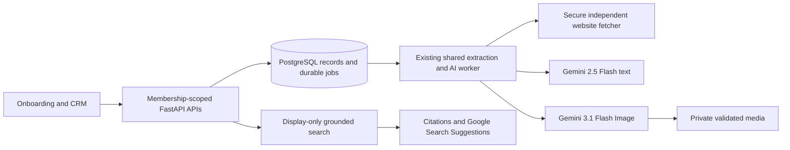

# Real AI onboarding — Phase 7.6

The authenticated five-step onboarding now uses the existing PostgreSQL, website research, Gemini, private media and shared worker services by default. The CRM uses the same competitor, studio, library and calendar components. No new publishing integration was introduced.

## What changed

1. **Your business:** searchable industry list with sectors, subcategories and custom Other entry. A website can create an explicitly provisional company using its hostname; research findings remain editable and require explicit review/application. Business type, state, city, country, public email and phone are supported. Every supported field carries evidence/classification; missing information remains empty. Reanalysis cannot silently replace saved edits.
2. **Brand:** independent website HTML/JSON-LD/header metadata supplies actual logo candidates and inline stylesheet colors. The selected validated logo is stored privately with its company, with authenticated preview, upload, replacement and removal. No generated replacement logo. Editable HEX/native color controls support up to eight saved colors. Logo-derived and website colors are labelled extracted; optional Gemini complementary colors are labelled suggestions. Description, services, audience, voice, keywords and guidelines reuse the saved brand profile.
3. **Competitors:** real intelligence is the default, without a demo toggle or static café recommendations. Gemini grounded suggestions display citations, sources and Search Suggestions in the existing transient search component. Independently sourced bulk research, progress, relevance, verification, approval, rejection, edits and reanalysis reuse the existing saved workflow. Research is optional for onboarding completion.
4. **Preferences:** platforms, formats, goals, tones, audience, language, topics, excluded topics, visual style and custom instructions persist to PostgreSQL. The generation snapshot uses the latest saved brand/preferences and only permitted approved independent competitor insights. Image briefs include the selected visual style and guidelines.
5. **First post:** the real studio is the default. Saved platform variations (up to three), text-only or image-enabled generation, private previews, caption/hashtag editing, independent caption/image regeneration, custom uploads, copy/download, save, approval and scheduling reuse the CRM implementation. Completion requires a saved generated post; it no longer requires a demo acknowledgement. New completed journeys have `demo_completed=false`.

Legacy demo component exports/data remain for compatibility but are not routed into authenticated competitor, studio, post library or calendar workflows. Historical demo completion records remain unchanged. Login continues to land in the CRM even when setup is incomplete.

## Bugs fixed

- Strict origin checks rejected Akoode's legitimate leading-www redirect. Only exact www aliases and HTTP→HTTPS upgrades are now admitted on the initial canonical request; each hop still passes public DNS/IP, URL, robots, timeout, redirect and size checks. Cross-domain/subdomain hops and HTTPS downgrades remain blocked.
- Over-strict all-or-nothing model evidence validation discarded rich supported analysis. The worker now prunes unsupported fields, then strictly revalidates remaining evidence. Actual retrieved contact/social passages can supply evidence-backed values when the model omits them. Unknown city/state are not inferred into facts.
- Default model fields could silently turn requested educational content into text, and valid reversed platform order was rejected. The provider wire schema requires explicit draft fields; requested platform coverage is normalized into request order. Bounded corrective retries receive a safe validation reason; invalid output never becomes a template fallback.
- Browser-only logo previews could replace the server-selected logo. Normal server restoration now wins; explicit browser draft recovery remains available.
- Color HEX editing rejected partially typed values. HEX input now validates on blur; palette cards wrap instead of overflowing.
- Loading the scheduling timezone could overwrite an already-entered date/timezone. User edits are now retained while those defaults load.
- Draft-recovery notices could overflow at mobile widths. Their content now wraps, and business form columns allow inputs to shrink.

## Architecture and safety boundaries

Google grounded text/URLs/suggestion HTML are not saved to competitor tables, crawled, imported, or passed to persistent content/research jobs. No direct grounded-result import is exposed. Existing operational search job metadata contains no grounded payload. Manual research is independently sourced. Brave remains an optional, separately permission-gated provider; no Brave key is required for Google's display-only feature. See [competitor intelligence](competitor-intelligence.md).

Logos are capped at 2 MB, public-host fetches use pinned DNS/IP and robots checks, and private paths are random and containment checked. Active SVG content, external references, entities, scripts, event handlers and unsafe CSS are rejected. A limited static SVG style whitelist supports the real Akoode logo. Authenticated logo responses use private/no-store, nosniff and sandbox CSP headers. Upload/replacement/removal use company membership and optimistic brand revisions; stale requests fail. Logos are never taken from grounded search results.

## APIs and database

Existing extraction, competitor, content, media, approval and scheduling routes are reused. Additions under `/api/v1/companies/{company_id}`:

| Route | Purpose |
| --- | --- |
| `GET /brand/logo` | Authenticated private selected logo |
| `POST /brand/logo/upload?revision=N` | Validated raw PNG/JPEG/WebP/SVG upload |
| `POST /brand/logo/from-website?job_id=UUID&candidate=N&revision=N` | Select a candidate from this company's independent extraction |
| `DELETE /brand/logo?revision=N` | Remove selected logo |
| `GET /onboarding/readiness` | Whether a saved generated post exists |

Three additive migrations follow the existing `e8f3c2a61b45` head:

- `c76a1f09e8b2`: nullable company state/public email/public phone.
- `d76b2a10f9c3`: one private selected `brand_logos` row per company; existing `brand_profiles.logo_url` references its private API route.
- `f76c3b21a0d4`: content target audience/topics/visual style; completion constraint accepts genuine completion without a demo flag. Downgrade refuses to rewrite real completed records into legacy demo records.

Existing records and old migrations were preserved. No environment file or credential was changed. Standard deployment: run `backend/.venv/Scripts/python.exe -m alembic upgrade head` from the backend, restart the API/shared worker, and rebuild/restart the frontend. Continue using the existing Gemini key and configured models; no additional key is needed.

## Controlled live verification

The tests used a newly created isolated `e2e-phase76-live-*` account/workspace, not an existing user's business. Temporary credentials stay outside the repository. The shared worker was restarted with current source before checks; its recorded runtime PID was 5496. The successful content service SHA-256 was `7ea1e35e9a77a4e91e02837a9f43b08d905a382a3da8d0e4d57bf39571a52bfa`. See [sanitized live metadata](phase76-live-results.json); no grounded response or credential is retained there.

| Check | Observed result |
| --- | --- |
| Akoode canonical redirect | `https://akoode.com` → `https://www.akoode.com/`; five pages researched |
| Business/brand fields | 14 populated supported fields, four services, country and public contacts; unsupported city/state left empty |
| Real logo | Actual `www.akoode.com/logo.svg`, validated static SVG, private authenticated preview; 11,071 stored bytes |
| Google Search | Nine supporting sources, 23 citations and Search Suggestions present; response display-only |
| Independent competitor | Independently selected Thoughtworks researched, verified, relevance 57, persisted and approved |
| Latest generation context | Saved Instagram/LinkedIn preferences, topics, exclusions, visual style, confirmed brand and permitted insights included |
| Real text/images | Instagram and LinkedIn drafts, two real PNG downloads verified (708,133 and 1,384,685 bytes) |
| Independent regeneration | Caption alternative completed without replacing saved original; image alternative completed and previous images retained |
| Custom upload | A downloaded real generated PNG was reuploaded as an explicitly uploaded QA asset |
| Save/approval/schedule | Caption edited, saved, approved, scheduled in Asia/Kolkata; persisted after logout/login |
| Completion | Completed with `demo_completed=false` |
| Other industry | NASA, `https://www.nasa.gov`, five pages; Aerospace industry and 16 supported fields applied |

Initial live Google search returned a temporary provider failure; bounded explicit retry succeeded. An initial text draft failed quality validation rather than falling back; the explicit required-field contract and correction fixed the subsequent controlled generation. Project Gutenberg could not be reached by the secure fetcher (`website_unavailable`); NASA provided the successful independent non-software checkpoint. These failures are retained in the sanitized report.

## Regression and screenshots

Automated provider tests use mocks/retained explicit QA fixtures, not paid generation. Live evidence above separately verifies real access. Backend tests cover canonical redirects and destination robots, malicious/static SVG, upload security/revisions/tenant isolation, latest preferences in a queued context, explicit wire fields and real completion without demo flags. Existing suites cover auth, extraction evidence, competitors, content/media, worker jobs, scheduling and database behavior. Browser tests cover the full real-default journey, provider failure recovery, company switching, persistence, industry/custom palette/preferences, tenant access, logo rendering and mobile layouts.

Final verification on 17 November 2026:

| Command | Result |
| --- | --- |
| Backend `.venv/Scripts/python.exe -m pytest -q` | **288 passed**, 59.16 s |
| Backend `.venv/Scripts/python.exe -m alembic check` | **No new upgrade operations detected** |
| Frontend `npm test` | **60 passed**, 10 files |
| Frontend `npm run test:e2e` | **33 passed**, 4.5 min; two focused palette/responsive rechecks passed after final HEX sizing |
| Frontend `npm run typecheck` | Passed |
| Frontend `npm run lint` | Passed |
| Frontend `npm run build` | Passed; 22 pages generated |
| Desktop/mobile capture script | 10 onboarding PNGs plus real saved Post Library PNG |

Earlier browser failures exposed the date-default race and recovery-banner overflow; both were fixed and the complete suite rerun successfully. One intermediate run was interrupted by host suspension; it is not counted as a passing run. After all jobs were idle, the shared worker was restarted once more to load the final evidence-passage prioritization (runtime PID 36616; analyzer SHA-256 `f4c6c1c5557a36517f23160580874f37df1733217ff98d9a751c98bd1577379a`). Contacts and social references are retained even when a long page exhausts the evidence budget.

Desktop and mobile captures are available locally under `frontend/artifacts/` (ignored generated artifacts). They show the isolated live Akoode company's saved records. Search was not started during capture; no Google grounded response was copied into screenshots. `frontend/scripts/capture-real-onboarding.mjs` reproduces them using the temporary QA account.

| Screen | Desktop | Mobile |
| --- | --- | --- |
| Business | [PNG](../frontend/artifacts/real-onboarding-business-desktop.png) | [PNG](../frontend/artifacts/real-onboarding-business-mobile.png) |
| Brand | [PNG](../frontend/artifacts/real-onboarding-brand-desktop.png) | [PNG](../frontend/artifacts/real-onboarding-brand-mobile.png) |
| Competitors | [PNG](../frontend/artifacts/real-onboarding-competitors-desktop.png) | [PNG](../frontend/artifacts/real-onboarding-competitors-mobile.png) |
| Preferences | [PNG](../frontend/artifacts/real-onboarding-preferences-desktop.png) | [PNG](../frontend/artifacts/real-onboarding-preferences-mobile.png) |
| First post | [PNG](../frontend/artifacts/real-onboarding-generate-desktop.png) | [PNG](../frontend/artifacts/real-onboarding-generate-mobile.png) |

[Saved Post Library with real images](../frontend/artifacts/real-onboarding-post-library.png). The first-post capture shows the latest retained caption-only alternative, which has no separate generated image; the original image-enabled generation and its images remain saved in the Post Library.

## Modified-file inventory

Paths below are relative to the repository; pre-existing unrelated changes were retained.

| Area | Files |
| --- | --- |
| Backend models/migrations | `app/models/onboarding.py`, new `app/models/brand_logo.py`, `alembic/env.py`, three new migration files named above |
| Schemas/APIs | `app/schemas/onboarding.py`, `brand_extraction.py`, `website.py`; `app/api/onboarding.py`, new `brand_media.py`; `app/main.py` |
| Website/analysis | `app/services/website_fetcher.py`, `website_extraction.py`, `html_extractor.py`, `gemini_brand_analyzer.py`, `extraction_jobs.py`; `app/workers/extraction.py` |
| Generation/persistence | `app/services/onboarding.py`, `competitor_intelligence.py`, `content_generation.py`, `media_storage.py`, `post_media.py` |
| Backend verification | `tests/test_real_onboarding.py`, `tests/test_onboarding.py`; new scripts `verify_real_onboarding.py`, `verify_real_onboarding_extras.py`, `verify_other_industry.py` |
| Frontend shared forms | New `components/industry-select.tsx`, `brand-logo.tsx`; `brand-extraction.tsx`, `brand-form.tsx`, `company-controls.tsx`, `onboarding.tsx`, `preferences.tsx`, `competitors.tsx` |
| Frontend real defaults | `components/content/studio.tsx`, `real-content.tsx`, `schedule-form.tsx`; `components/dashboard/posts.tsx`, `calendar.tsx`, `sections.tsx`; `app/globals.css` |
| Frontend state/contracts | `lib/company-api.ts`, `company-state.ts`, `brand-extraction-api.ts`, `storage.ts`; `store/use-company-persistence.ts`; `types/index.ts` |
| Browser QA | `tests/e2e/journey.spec.ts`, `grounded-search.spec.ts`, `extraction.spec.ts`, new `real-onboarding.spec.ts`; new `scripts/capture-real-onboarding.mjs` |
| Documentation | This document, `phase76-live-results.json` and `competitor-intelligence.md` |

Backend paths in this table are under `backend/`; frontend paths under `frontend/src/` except tests/scripts.

## Remaining limitations

- Public websites may deny access, require unsupported crawl delays, block this host or render details only in JavaScript. Manual entry and explicit review remain available; missing details are never invented.
- Color extraction reads available inline styles and validated logo pixels/SVG colors; external CSS files are not crawled. Some logo candidates can be partner/header assets; the user explicitly selects the correct brand logo.
- Gemini/provider quota and network availability still apply. Correctness checks can reject drafts; the UI keeps inputs and offers explicit retry without fake output.
- Carousel slides and meme layouts remain concepts where the existing generator does not render them. Existing downloadable images are real validated assets.
- Search suggestions are intentionally separate from saved competitors. Fully automated grounded discovery-to-persistence remains disabled.
- Social publishing is not implemented in Phase 7.6. Scheduling retains the existing Awaiting Publisher boundary.
- Local screenshot artifacts and private QA media are not committed or publicly hosted. QA scripts are opt-in and can incur provider costs when invoked with `--live`.

## First-screen analysis review follow-up

Completed website analysis now shows each finding's value directly in its summary instead of a list of labels alone. The business screen has an explicit **Use these findings and continue** action that applies available reviewed findings and opens Brand identity. Individual selection, editing and source inspection remain available; nothing is applied merely by analysis completing. Missing findings are labelled unavailable and do not replace manual details. Current state/public contacts are included in comparisons. Manual business/brand edits are saved with revision checks before applying selected findings, preserving entered location and other unselected data. Optional undefined result fields are treated as unavailable.

The regression test `first-step findings show their values and continue without discarding manual location` verifies visible findings, continuation and PostgreSQL persistence of manual Gurgaon/Haryana when website city/state are unknown. Frontend unit tests, TypeScript and lint passed; the targeted company/extraction/preferences browser suite passed nine tests.

## Automatic editable Brand Identity fields

Opening an unconfirmed Brand Identity form now loads the latest completed analysis for the same website and fills missing services, audience, voice, colors, keywords, social links and guidelines automatically. A short initial manual description on an otherwise empty manual brand can be replaced by the analyzed description. Confirmed profiles and existing populated fields are retained. Only previously validated model findings are used; unavailable facts stay empty, with model-provided color/tone suggestions used only when present. The values save as an unconfirmed draft through the existing revision-checked apply API and remain editable. A company/job-scoped browser marker prevents the same analysis from filling deliberately cleared fields again on refresh. The form waits for initialization before accepting edits to avoid racing an automatic fill.

Verification: 63 frontend unit tests passed, including complete field mapping, saved/confirmed profile preservation and model-only suggestions. Five extraction browser tests passed, including automatic fill from a completed result, editing the resulting services, saving and refresh persistence. Existing company/preferences regressions also passed; TypeScript, lint and production build passed. No additional paid model request or database migration was required.

## Bakingo generation validation fix

A real Bakingo Instagram/LinkedIn image request failed because the quality validator rejected every occurrence of `certified`, including `FSSAI certified` already present in the confirmed brand description/guidelines. Validation now accepts only a matching named qualification present in confirmed facts; bare `certified` and an invented authority remain rejected. Generation instructions reflect that distinction. A bounded corrective retry now gives fixed, actionable instructions for a rejected promotional claim/link, numeric claim, platform mismatch or content-type mismatch without echoing rejected model output.

The idle shared worker was restarted with the updated content service (runtime PID 22352). The original failed request was retried once through the existing membership-checked admission service using current brand context, the same cake topic, Instagram/LinkedIn selections and image settings. Both text drafts completed using `gemini-2.5-flash`; both private PNG assets completed and passed Pillow file verification (928?1152, 1,264,070 bytes; 1024?1024, 998,858 bytes). The drafts are retained for the user to review/save; no automatic approval, scheduling or publication occurred. Prior failed jobs remain intact. See `bakingo-generation-fix.json` for metadata only.

Verification: 47 focused backend content/media/onboarding tests passed, including supported FSSAI qualification, invented ISO rejection, and actionable bounded retry. No frontend, credential, migration or provider configuration change was needed.
