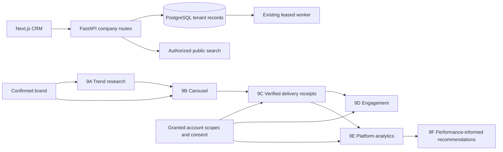

# SocialAI six-capability roadmap

## Phase 0 audit

The repository has a Next.js CRM, cookie-authenticated FastAPI API, PostgreSQL persistence and a shared worker. The worker claims leased AI jobs, runs brand extraction and advances due schedules. Company route permissions conceal unauthorized tenants, permit members to read and reserve writes for owners/admins. Current onboarding has Business, Brand and Goals, a durable first-post handoff and legacy progress mapping. The current Overview shows four company-scoped metrics, a Studio brief handoff and bounded post/calendar views. Good reference points are `backend/app/core/permissions.py`, `backend/app/workers/extraction.py`, `backend/app/services/simplified_onboarding.py` and `frontend/src/components/dashboard/crm-overview.tsx`.

The audit found 22 application tables at Alembic head `87aa6b6cc390`. The local runtime reports OpenAI text and search configuration. The linked provider's current account entitlements were outside the live audit. Before the Phase 9A changes, 91 targeted backend tests and 88 frontend unit tests passed.

| Capability | Implemented and evidence | Gap and external dependencies | Expected storage and verification |
| --- | --- | --- | --- |
| Brand Intelligence | Confirmed editable profiles, verified website findings, logo/media and palette, audience and brand guidelines. Existing generation/research snapshot through `competitor_intelligence.brand_context`. See `test_real_onboarding.py`, `test_extraction_jobs.py` and `test_simplified_onboarding.py`. | Keep private profile fields out of provider searches. Move shared snapshot semantics behind a domain-neutral interface if more consumers require it. Website accessibility and unsupported evidence stay explicit. | Preserve records and versions. Test legacy drafts, site/tenant isolation, evidence classifications and immutable generation context. |
| Trend Research | Competitor discovery has display-only OpenAI and Google search and a distinct independent website research workflow. No trend research workspace in the baseline. See `openai_search.py`, `gemini_search.py` and `grounded-search.spec.ts`. | 9A uses the configured OpenAI search path for recent public evidence and attributable ideas. Authorized restricted feeds, result retention and recurring checks each need separate rights, consent and quotas. | Add a company-scoped independent note table and operational journal kind. Test public-link validation, citations, session-only results, usage limits, storage provenance, tenant roles and Studio handoff. |
| Content Generation | Captions, quality controls, images and regenerations, private media, version history, approvals and recovery. Carousel schema supports 2–8 outline slides. See `content_generation.py`, `content_handlers.py`, `test_content_quality.py` and `content-media.spec.ts`. | 9B adds rendered slide assets and independent slide revision/export. Requires existing approved text/image access and per-platform export requirements. | Versioned slide placements over existing media with revision-safe linking. Test partial failures, reorder/regenerate/export, ownership and approval/scheduling invalidation. |
| Scheduling and Publishing | Calendar, UTC instants, immutable schedule events and awaiting-publisher transition. LinkedIn OIDC connect/reconnect/disconnect and encrypted credentials. See `test_scheduling_worker.py`, `test_social_accounts.py` and `social-accounts.spec.ts`. | Publishing is missing. 9C requires an approved provider product, actual granted posting scopes and explicit account-level scheduling consent. LinkedIn member and organization endpoints have different access requirements. | Delivery attempts and receipt IDs/URLs beside existing schedules. Use explicit delivery states, an idempotency token per approved revision and reconciliation when remote outcome is ambiguous. Verify retries, revocation, posts without receipts, tenant safety and no send from approval alone. |
| Engagement | No inbox or message collection. Social connections do not grant inbox access by themselves. | 9D needs approved comment/mention/message endpoints, permitted recipients and messaging windows. Start with actionable comments when authorized. Human review before sending. | Tenant-scoped provider conversation IDs, assignment/status, reply drafts and attempts. Verify deduplicated ingestion, out-of-order events, window enforcement, redaction/deletion and cross-tenant denial. |
| Analytics | CRM generation totals and saved-post counts are internal operations data. Analytics route says no integration. See `services/crm.py`, `test_crm_dashboard_stats.py` and `crm.spec.ts`. | 9E needs authorized platform analytics endpoints and a confirmed mapping to published receipts. Availability differs by platform, account type, timeframe and metric. | Metric snapshots with definition, period, source and collection time. Test missing vs zero, pagination, duplicates and windows. 9F builds evidence-linked recommendations across meaningful samples and avoids causal claims. |

## Architecture and dependency diagram

Use company identifiers on every record, read and job. Model source origin, publisher URL, optional published date, retrieval time and confirmation independently from AI interpretation. Keep credentials server-side and encrypted. Audit provider and model, operation state and bounded usage separately from research content. Reuse leases for durable jobs with permissible output. On-demand display-only search can use the same operational journal without caching answers or replaying expired work.

## Permissions and release gates

- Brand and notes use workspace roles. Searches disclose public business context to the active search provider and require owner/admin action. OpenAI search must be enabled and the project's model/tool access must succeed. Inline citations must stay clickable. Search permission does not establish content storage or reuse rights for third-party material. The first release displays provider output during the request session and accepts independently sourced notes through a separate form. [OpenAI web search](https://developers.openai.com/api/docs/guides/tools-web-search?api-mode=responses) · [OpenAI service terms](https://openai.com/policies/service-terms/).
- Publishing, comments, private messages and metrics each require verified application access and actual granted scopes for the target account. LinkedIn OIDC profile scopes alone are insufficient. Treat organization admin status, member consent and app approval as distinct checks. Validate individual endpoints before exposing their UI. [LinkedIn permissions](https://learn.microsoft.com/en-us/linkedin/marketing/increasing-access?view=li-lms-2026-05) · [Community Management app review](https://learn.microsoft.com/en-us/linkedin/marketing/community-management/community-management-app-review?view=li-lms-2026-06).
- Treat Instagram professional accounts and Facebook Pages as separate account types. Confirm Meta app access, endpoint permissions, messaging windows and the Page role before expanding the adapter. [Meta publishing reference](https://developers.facebook.com/docs/instagram-platform/instagram-graph-api/reference/ig-user/v21.0/) · [Meta Insights access](https://developers.facebook.com/docs/insights/overview/) · [Meta conversations permissions](https://developers.facebook.com/docs/graph-api/reference/page/conversations/).
- Before adding background research, verify source licenses, caching/export rights, consent per company, frequency, rate limits, cancellation, retained-data expiry and provenance. Restricted conversations require an authorized feed and provider review. Protect user-authored notes from broad search context and keep social tokens and inbox text out of general logs.

## Implementation order

1. **9A** Ship on-demand trend research, citations and independently sourced notes. Keep competitors available as their own workflow. Require evidence review before using a research note in Studio.
2. **9B** Add rendered slides, stable ordering, per-slide revisions, visual references, preview and export. Confirm formats and limits per target platform. Add reviewed trend references to generation snapshots.
3. **9C** Build one verified publishing adapter first. Add explicit Publish Now and scheduled opt-in, provider receipts, retry/reconciliation and error states. Expand only after the first adapter passes provider sandbox and tenant tests.
4. **9D** Add authorized comment ingestion, then assignment, reply review and delivery. Assess mentions and messages separately with provider policy and data-retention checks.
5. **9E** Collect supported, timestamped metrics linked to provider identifiers. Make unavailable metrics explicit and keep operational AI counts separate.
6. **9F** Surface recommendations with cited observations, sample sizes and limitations.

## Test strategy

Use the existing PostgreSQL rollback fixtures and mocked providers. Verify route origin and role enforcement, company switching, source provenance, application and provider timeouts, duplicate requests and schema migrations. Run TypeScript, lint, unit tests and browser interaction tests on the actual frontend. For publishing or messaging, first test the provider's sandbox and simulated retries. Any paid or live write test needs a separately bounded request or delivery limit. Compare pre-existing records around additive migrations. Existing deep links and CRM navigation stay usable throughout the rollout.

## Phase 9A handoff

**Trend Research** is available at `/dashboard/trends`, alongside the existing competitor workspace. Search offers 7-, 30- and 90-day windows and an optional focus. The date window and source dates in the live answer are interpreted by the search model. Users can verify dates and reported facts at the linked sources. Original post angles are presented as suggestions. Users can independently confirm and save a title, HTTPS source, optional publication date and a summary they wrote. A saved note can be dismissed, used for a fresh search for post angles, or selected as the title of an editable Studio brief. Opening Studio incurs no generation request.

| API | Access and behavior |
| --- | --- |
| `GET /companies/{id}/trend-capabilities` | Member read. Reports local search configuration, confirmed brand and write role. |
| `POST /companies/{id}/trend-search` | Owner/admin with a confirmed brand. Uses configured OpenAI web search with company sector, market and user-entered focus. A selected reviewed note is included only when the user requests angles for it. |
| `GET /companies/{id}/trend-notes` | Member read with bounded pagination. |
| `POST /companies/{id}/trend-notes` | Owner/admin write with independent-review attestation and a request key. |
| `DELETE /companies/{id}/trend-notes/{noteId}` | Owner/admin dismiss operation. Repeated dismissals return the same outcome and the original record is retained. |

Search performs up to four built-in tool calls per provider response within the existing search timeout, retry and usage budgets. It checks for tool use and clickable citations and excludes major social domains from this public research path. Application logs and database records keep the operational status and usage rather than live answer, citations, prompt or note text. The shared worker closes expired live-search leases. The API provides fresh search on explicit request and never schedules or replays a display-only run. [OpenAI Responses tool-call bounds](https://developers.openai.com/api/reference/resources/responses/methods/create).

Migration `a74e2c9d70f1` adds `trend_notes` and permits `trend_search` in the existing AI job journal. Company, brand, onboarding, post, media, schedule, AI job and account counts matched before and after the migration. Alembic found no pending schema operations. The local shared worker was restarted with the new code while both AI queues were idle.

Phase 9A uses OpenAI public search when configured and independent notes are available separately. Live model entitlement and source redistribution rights need verification before retaining provider output. Authorized social conversations and recurring checks need endpoint or source approvals, explicit consent and a retention policy. Real publishing, inbox actions, platform analytics and rendered carousel slides remain the next gated releases.

### Phase 9A verification

| Check | Result |
| --- | --- |
| Full backend suite | 410 passed |
| Frontend unit suite | 88 passed |
| Browser regressions at port 3001 | 10 passed across Trend Research, competitor search, CRM Overview and onboarding |
| TypeScript, ESLint and production build | Passed |
| Database | Upgrade applied. Existing record counts matched and Alembic check passed. |

The browser verification exercised quota recovery, clickable citations, an independent note saved to PostgreSQL, note-specific angles, persistence after reload, the edited Studio brief handoff and dismissal. The API tests cover role and tenant isolation, quotas, duplicate requests, no saved provider output, rejection of missing tool evidence and expiry without replay. Provider behavior was mocked. The phase used zero paid AI calls.

